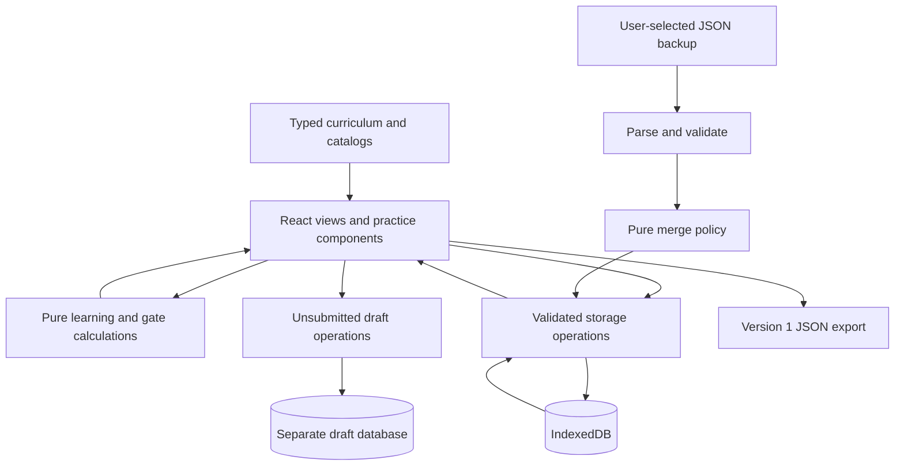

# Application architecture

Atlas is a static React application with a deterministic learning engine and browser-local persistence. GitHub Pages serves the built HTML, JavaScript, styles, fonts, and SVG asset. No application server, account database, API secret, or paid infrastructure is required for this release.

The design separates curriculum content from assessment rules and persistence. This makes content review possible without changing storage code, and lets the learning engine be tested without rendering React or connecting to a cloud account.



## Runtime and ownership

| Owner                                      | Responsibility                                                                                                                   |
| ------------------------------------------ | -------------------------------------------------------------------------------------------------------------------------------- |
| `src/main.tsx`                             | React root, bundled fonts, and global styles                                                                                     |
| `src/App.tsx`                              | App shell, navigation/search, fragment routing, storage loading, notifications, and render-error boundary                        |
| `src/components/Pages.tsx`                 | Dashboard, section/lesson views, review queue, migration, portfolio, certification records, resources, career gates, and backups |
| `src/components/Practice.tsx`              | Interactive exercises, practical evidence forms, constrained terminal simulation, and diagnostic practice                        |
| `src/lib/learning.ts`                      | Record types, initial reported history, answer comparison, retrieval scheduling, lesson states, and project-attestation checks   |
| `src/lib/gates.ts`                         | Capability requirements and their evaluation against current lesson/project evidence                                             |
| `src/lib/storage.ts`                       | Runtime validation, safe links and images, JSON import/export, merge semantics, and IndexedDB transactions                       |
| `src/lib/drafts.ts` and `useDraftState.ts` | Separate local draft persistence and form restoration without assessment or inclusion in backups                                 |
| `src/content/types.ts`                     | Shared lesson, section, exercise, and resource contracts                                                                         |
| `src/content/foundations.ts`               | Foundational teaching and practicals                                                                                             |
| `src/content/advanced.ts`                  | Usable bridge lessons for later sections                                                                                         |
| `src/content/index.ts`                     | Assembled lesson catalog, the real-AWS field checkpoint, and expansion manifest                                                  |
| Other `src/content/*.ts`                   | Section map, projects, certifications, and curated resources                                                                     |
| `src/styles.css`                           | Responsive layout, typography, interaction states, and accessibility styling                                                     |
| `vite.config.ts`                           | React build, ES2022 target, and repository-specific asset base                                                                   |

React 19 and TypeScript provide the component and type layer; Vite produces the static application with separate curriculum and vendor chunks. Lucide icons and Fontsource fonts are bundled with the site. The app does not need a runtime font request to a third-party font CDN.

## Routing and GitHub Pages

The asset base is `/project-atlas-school/`. The route is stored after `#/`, for example:

```text
/project-atlas-school/#/dashboard
/project-atlas-school/#/section/4
/project-atlas-school/#/lesson/troubleshoot-nginx
/project-atlas-school/#/portfolio/linux-service
/project-atlas-school/#/settings
```

The hash is handled in the browser, so GitHub Pages receives the static application path when a lesson is refreshed. There is no server-side routing or rewrite dependency. The shell listens for `hashchange`, resets navigation/search state, scrolls, and moves focus to the main content. Unknown top-level routes receive the not-found view.

Renaming the repository requires updating Vite’s base, public links, and any test-server URL. Moving to a different origin changes the IndexedDB storage boundary. Data is scoped by browser origin/profile, not by the hash route or repository path; other applications under the same origin are not separate security principals merely because their paths differ.

## Content and assessment contracts

Stable lesson and exercise IDs connect routes, prerequisites, progress records, and content tests. Preserve their meaning across releases. Changing an ID is a data migration concern, not a cosmetic edit. Prerequisites must resolve without cycles. Resource IDs and certification section references must resolve. Project lesson prerequisites must refer to actual lessons.

The section topic map is broader than the current released lesson depth. Every released lesson must provide substantive concepts, demonstration, retrieval, and a practical evidence contract. A `released` bridge is complete within its declared scope; it does not make its entire section or associated certification preparation complete. The content test suite checks structural completeness and references, not full pedagogical effectiveness or every command’s real-world behavior.

Answer comparison normalizes surrounding/outer whitespace and typographic quotes while preserving shell case and quoted content unless an exercise explicitly opts out of case sensitivity. It compares against known accepted answers; it is not a shell parser or a general semantic grader. Add legitimate variants deliberately. Do not loosen command comparison globally to make a failing fixture pass.

The current learning policy is:

- Multiple-choice and typed binary answers count as recognition. They do not establish independent retrieval.
- A demonstrated lesson requires at least two distinct unaided retrieval successes, including a core recall/fill exercise, plus a satisfactory practical submission.
- Independence additionally requires delayed retention of at least two distinct retrievals, including core recall/fill, and an independent practical declared without hints or solution use.
- Successful spaced retrievals must be separated by at least 24 hours. Review intervals progress through 1, 3, 7, 14, and 30 days; incorrect/hinted attempts return sooner. An overdue reminder alone does not erase prior retention.
- Current answer keys are reapplied to stored successful retrievals, and future-dated records do not earn current progress. The local clock and user-entered evidence are not trusted external attestations.

`getLessonProgress` and `getExerciseProgress` own the exact rules. Gates in `gates.ts` require particular lesson states, named project evidence, and project counts; they never advance because four or six calendar months elapsed. The Month-4 gate includes real AWS field evidence. The Month-6 gate includes the capstone and stronger engineering evidence.

Practical satisfaction checks rubric coverage, a substantive explanation, and supporting output/commands/code/configuration or screenshots. These checks establish record completeness, not the truth of a terminal session. “Portfolio Verified” requires a project URL, evidence, all rubric items, and named peer-review notes; reviewer identity is not authenticated. Certification entries store reported practice scores, not earned official credentials.

## Persistent data

The IndexedDB database is `project-atlas-school`, database version 1, with a `state` object store and one `atlas` record. That record uses the separate application schema version `1`:

```typescript
type AtlasData = {
  version: 1;
  createdAt: string;
  updatedAt: string;
  priorHistory: PriorEvidence[];
  attempts: ExerciseAttempt[];
  submissions: LabSubmission[];
  projects: ProjectSubmission[];
  certifications: CertificationScore[];
};
```

Timestamps are canonical ISO strings. Records carry stable IDs. Attachments are validated PNG/JPEG/WebP data URLs embedded in practical records, so a normal backup includes them. No screenshot or submission is uploaded by the storage module.

First use seeds sixteen reported Atlas competency records and empty current attempts/submissions. Cleanup practice and foreground/background job-control evidence have separate records. Reported practice does not skip current assessment. A storage error does not trigger replacement of an existing database; the shell displays an error and can still present lessons with initial in-memory data. Save success is reported only after the storage operation resolves.

Persistence of the learning record goes through `createStorage()` operations:

```text
loadData()
appendAttempt(attempt)
saveSubmission(submission)
saveProject(project)
saveCertificationScore(score)
importBackup(json)
```

Each operation opens a read-modify-write transaction, reads the latest record, validates it, applies its update, validates the result, and commits. IndexedDB serializes these transactions across tabs, reducing lost updates. The UI also reloads on window focus; it does not implement continuous cross-tab broadcast or cross-device sync.

### Unsubmitted drafts

Practical and project forms use `useDraftState` with `lab:<lessonId>` or `project:<projectId>` keys. `drafts.ts` owns a separate IndexedDB database, `atlas-school-drafts`, version 1, with a `drafts` store. Its records contain a draft-format version, form value, and save time. These records never enter `AtlasData`, learning calculations, or version-1 JSON backups.

The hook keeps in-memory form state for route changes and queues writes per key to preserve the order of changes in the current page. IndexedDB restores unfinished forms after refresh; draft-format checks are distinct from the stricter submitted-evidence validator. Draft errors preserve the saved learning record and tell the learner to copy unfinished work. Pending writes can trigger a browser leave warning, but that warning is not a durability guarantee.

Explicit **Save evidence** or **Save project evidence** runs the normal validated learning-record save before clearing its draft. Until that action succeeds, the form remains unassessed and excluded from backups. Draft persistence has no cross-device sync, merge protocol, or authenticated provenance. Do not apply the learning-record conflict guarantees to concurrent editing of the same draft in multiple tabs.

## Validation and merge behavior

`parseBackup` checks the JSON and delegates to `validateData`; import completes validation before attempting a saved-state mutation. Validation rejects unsupported versions/fields, invalid IDs/timestamps/enumerations, unsafe links, malformed images, conflicting duplicate records, and excessive sizes. Runtime validation is necessary even when the source is TypeScript because imported JSON is untrusted input.

Current boundaries include a 50 MiB backup, 3 MiB per screenshot, six screenshots and twenty links per practical, and finite collection/text limits. Image MIME type, base64 shape, byte length, and format header are checked. SVG attachments are not accepted. These checks are not an antivirus scan or a guarantee that the image is authentic evidence. Link fields accept absolute HTTP(S) URLs without embedded credentials; they do not verify the remote content.

The pure `mergeData` policy is intentionally explicit:

| Record family                               | Merge policy                                                                                                            |
| ------------------------------------------- | ----------------------------------------------------------------------------------------------------------------------- |
| Retrieval attempts and certification scores | Immutable by ID. Identical duplicates collapse; conflicting records with the same ID reject the merge.                  |
| Practical submissions                       | Keep the record with the later `at` value for the same ID. Different contents with an equal timestamp reject the merge. |
| Projects                                    | Same latest-record policy using `submittedAt`; equal-time conflicts reject.                                             |
| Prior history                               | Preserve existing records by ID; add new incoming IDs.                                                                  |
| Root metadata                               | Preserve earliest creation and an appropriate latest update timestamp, then validate the merged record.                 |

The merge is atomic with the database update. On conflict, retain both original backup files and resolve the discrepancy explicitly. There is no destructive replace-import or automatic conflict guessing. The current schema has no deletion tombstones or authenticated provenance, so it must not be represented as a complete distributed synchronization protocol.

## Privacy, durability, and failure handling

IndexedDB is local persistence, not an encrypted vault. Anyone with access to the browser profile or exported file may be able to read its contents. Submissions should contain redacted evidence, never credentials, tokens, cookies, or private command history. Backups travel only when the learner deliberately exports/transfers them. External resource visits and normal GitHub Pages hosting are separate network interactions.

Browser quota, eviction, private browsing, blocked storage, and user-cleared site data can remove or prevent persistence. `StorageError` translates common failures into actionable messages. Database upgrade blocking closes the opened connection appropriately, and transactions abort rather than treating a failed write as success. Regular exports are the recovery mechanism; a static site deployment cannot restore a deleted browser database.

The app includes a React render-error boundary, accessible status/error messages, labeled controls, a skip link, and route focus management. These features reduce known usability problems; they do not establish exhaustive accessibility conformance. Screenshots and real keyboard/mobile checks remain necessary.

## Simulation and cloud boundaries

The terminal simulator is a small deterministic model for teaching. It does not invoke a shell, run arbitrary commands, manage Linux services, or contact AWS. Its success is kept separate from real practical evidence. Editable code/command panels hold learner text; they are not a remote execution service.

Local Terraform and Docker lessons are explicitly scoped. Cloud design artifacts cannot satisfy actual AWS field requirements. The application never provisions AWS resources, accepts provider terms, stores API keys, or spends on the learner’s behalf. Live labs require a separate authorized environment and a current cost/cleanup plan.

## Build, deployment, and rollback

`npm run build` runs TypeScript project checks and Vite, producing `dist/` for GitHub Pages. [`.github/workflows/deploy.yml`](../.github/workflows/deploy.yml) is the source of truth for build triggers, permissions, and artifact publication. It verifies pushes to `main`, pull requests, and manual dispatches using Node 22, lint, unit tests, the production build, and Chromium browser tests. Only non-pull-request runs on `main` upload and deploy the Pages artifact. The deploy job requires verification and uses Pages/OIDC permissions and the `github-pages` environment.

Select GitHub Actions as the repository’s Pages source, build from the intended revision, and publish the `dist/` artifact through the Pages environment. Publication is proven by a successful deployment plus checks of the published root, assets, hash routes, and local persistence—not by a local build alone.

Rollback uses a reviewed revert or known-good source revision rebuilt by the workflow. Data compatibility must be considered separately: deployed code can roll back while a learner’s version-1 data persists. Export first before a schema change. Do not ship a validator that rejects existing data without an explicit migration and recovery path.

## Testing and future extensions

Vitest covers the pure learning engine, storage using `fake-indexeddb`, and content contracts. Browser tests use Playwright for the implemented end-to-end scenarios. An automated browser pass does not certify actual Linux/cloud commands, every external link, Safari-specific behavior, or every assistive technology. Keep test results tied to the tested revision and browser.

The storage API and pure merge function provide a useful future boundary for an optional sync adapter. A sync design still needs explicit consent, authentication, authorization, encryption/transport choices, deletion semantics, conflict handling, retries, schema migration, and backup recovery. Keep local-only mode usable and avoid introducing a paid backend as an implicit requirement. No such adapter or account system exists in this release.

Other maintainable next steps include splitting large view modules when their ownership becomes clearer, adding more assessment variants, and expanding the documented content backlog. Preserve stable IDs, testable pure rules, transaction integrity, and honest evidence labels during those changes.
